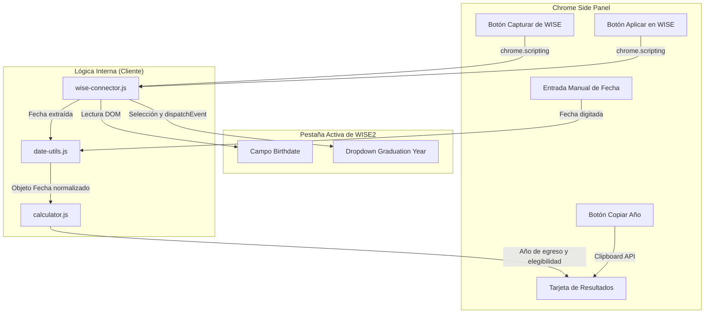

# Design: 001 — Validador de Año de Egreso para Seminario

> Requirements: [.ai/sdd/specs/001-validador-egreso/requirements.md](file:///c:/Users/GonzaloNicolasBalder/OneDrive%20-%20Church%20of%20Jesus%20Christ/Aplicaciones/Multiherramientas%20SEI/.ai/sdd/specs/001-validador-egreso/requirements.md)  
> Status: Approved  
> Last Updated: 2026-10-23  

---

## 1. Executive Summary

Este documento técnico define la arquitectura e implementación de la primera micro-herramienta modular del kit **Multiherramientas SEI**: el *Validador de Año de Egreso para Seminario*. La solución se implementa como una extensión para Google Chrome bajo el estándar **Manifest V3**, alojada principalmente en el **Chrome Side Panel** para permitir una operación paralela y fluida mientras el Asistente Administrativo interactúa con la plataforma institucional **WISE2**.

La herramienta adopta un enfoque desacoplado en tres capas:
1. **Motor de Cálculo Puro (`calculator.js`):** Función determinista, sin dependencias del DOM, que replica fielmente las reglas de corte al 1 de Julio y 4 años de cursado según la directiva oficial de Seminarios e Institutos.
2. **Conector Contextual WISE2 (`wise-connector.js`):** Script ligero inyectado bajo demanda (`chrome.scripting.executeScript`) en la pestaña activa para lectura del campo `Birthdate` y selección automática en `Graduation Year` con disparo de eventos sintéticos (`change`/`input`).
3. **Controlador e Interfaz de Side Panel (`sidepanel.js` / `validador.html`):** Vista moderna, construida con Vanilla CSS de alto contraste y diseño responsivo, dotada de microinteracciones reactivas (cálculo < 10ms, copiado con feedback visual y switch de ambigüedad de formato).

---

## 2. Requirements Mapping

| Requisito | Cobertura en Diseño | Sección / Mecanismo | Notas |
|-----------|---------------------|----------------------|-------|
| **FR-001** (Cálculo de Ingreso y Graduación) | `calculator.js` / `calculateSeminarGraduation()` | Sección 4.2 / 4.3 | Corte al 1/Julio (`month < 7`) y duración de 4 años lectivos |
| **FR-002** (Elegibilidad actual) | `calculator.js` / `evaluateEligibility()` | Sección 4.3 | Determina estados: `ELIGIBLE`, `TOO_YOUNG`, `EXPIRED`, `OVER_AGE` |
| **FR-003** (Captura de fecha de WISE2) | `wise-connector.js` (`extractBirthdate`) | Sección 4.4 / 5 | Localización resiliente por selectores y etiquetas en WISE2 |
| **FR-004** (Entrada manual y parsing) | `date-utils.js` (`parseDateString`) | Sección 4.2 | Normaliza `DD/MM/AAAA`, `DD-MM-AAAA` y formatos ISO |
| **FR-005** (Copia al portapapeles) | `navigator.clipboard.writeText` | Sección 4.2 / 7 | Copia con un clic y animación de feedback visual |
| **FR-006** (Autoselección en WISE2) | `wise-connector.js` (`applyGraduationYear`) | Sección 4.4 / 5 | Inyecta y selecciona la opción en el `<select>` de WISE2 |
| **FR-007** (Detección de ambigüedad) | `date-utils.js` + Switch UI | Sección 4.2 / 8 | Detección cuando día y mes son $\le 12$ |
| **NFR-001** (Usabilidad en Side Panel) | `manifest.json` (`side_panel`) + CSS | Sección 3 / 7 | Operación continua sin popups emergentes efímeros |
| **NFR-002** (Privacidad absoluta P-001) | Procesamiento 100% en memoria | Sección 6 | Cero almacenamiento persistente ni transmisión de datos |
| **NFR-003** (Confiabilidad y fidelidad) | Suite de pruebas unitarias Vitest | Sección 11 | Casos de prueba idénticos a `Verificador seminario.html` |
| **NFR-004** (Estética visual de calidad) | Design Tokens en `sidepanel.css` | Sección 7 | Tipografía Inter, tema esmeralda para éxito y slate neutro |

---

## 3. System Architecture

### 3.1 Component Overview

| Componente | Responsabilidad | Límites | Notas |
|------------|-----------------|---------|-------|
| `manifest.json` | Declaración de la extensión Manifest V3 | Permisos mínimos: `activeTab`, `sidePanel`, `scripting` | Sin permisos excesivos ni `<all_urls>` |
| `background/service-worker.js` | Inicialización de la extensión y control del Side Panel | Ciclo de vida del worker | Habilita apertura del panel al hacer clic en el ícono |
| `sidepanel/sidepanel.html` | Shell contenedor y layout principal del Side Panel | Vista de usuario en Chrome | Carga el módulo de la herramienta activa |
| `tools/validador-egreso/calculator.js` | Motor matemático puro de fechas y cohortes | Sin DOM, 100% testeable | Entrada: día, mes, año. Salida: objeto de resultado |
| `tools/validador-egreso/validador.js` | Controlador de vista y eventos de la herramienta | Lógica UI en Side Panel | Coordina entrada, cálculo, copiado y conector |
| `content/wise-connector.js` | Script inyectable en la pestaña activa de WISE2 | Contexto DOM de WISE2 | Solo se ejecuta al pulsar "Capturar" o "Aplicar" |
| `shared/date-utils.js` | Normalización y validación sintáctica de fechas | Utilidad pura | Soporta formatos regionales y detección de ambigüedad |

### 3.2 Data and Control Flow



---

## 4. Implementation Design

### 4.1 Estructura de Directorios

```text
src/
├── manifest.json
├── background/
│   └── service-worker.js
├── sidepanel/
│   ├── sidepanel.html
│   ├── sidepanel.css
│   └── sidepanel.js
├── tools/
│   └── validador-egreso/
│       ├── validador.html
│       ├── validador.css
│       ├── validador.js
│       ├── calculator.js
│       └── calculator.test.js
├── content/
│   └── wise-connector.js
└── shared/
    ├── date-utils.js
    └── dom-utils.js
```

### 4.2 Interfaces Principales y Contratos de Datos

```ts
/** Objeto de resultado del motor de cálculo */
export interface SeminarCalculationResult {
  day: number;
  month: number;
  year: number;
  currentAge: number;
  bornBeforeJuly: boolean;
  intakeYear: number;
  graduationYear: number;
  ageAtIntake: number;
  ageAtGraduation: number;
  status: 'ELIGIBLE' | 'TOO_YOUNG' | 'EXPIRED' | 'OVER_AGE';
  currentGrade?: number; // 1 a 4 si es ELIGIBLE
  title: string;
  message: string;
}

/** Contrato para el conector de WISE2 */
export interface WiseConnectorResponse {
  success: boolean;
  action: 'READ_BIRTHDATE' | 'APPLY_GRADUATION';
  value?: string;
  error?: string;
}
```

### 4.3 Algoritmo de Cálculo (`calculator.js`)

```js
export function isBornBeforeJuly1(day, month) {
  return month < 7; // Enero (1) a Junio (6)
}

export function calculateSeminarGraduation(day, month, year, referenceDate = new Date()) {
  const currentYear = referenceDate.getFullYear();
  const currentMonth = referenceDate.getMonth() + 1;
  const currentDay = referenceDate.getDate();

  // 1. Edad actual exacta
  let currentAge = currentYear - year;
  if (currentMonth < month || (currentMonth === month && currentDay < day)) {
    currentAge--;
  }

  // 2. Regla del 1 de Julio: 14 años antes del 1/Julio
  const bornBeforeJuly = isBornBeforeJuly1(day, month);
  const intakeYear = bornBeforeJuly ? (year + 14) : (year + 15);

  // 3. Duración del programa: 4 años continuos
  const graduationYear = intakeYear + 3;
  const ageAtIntake = 14;
  const ageAtGraduation = graduationYear - year;

  // 4. Verificación de elegibilidad
  let status = 'ELIGIBLE';
  let title = '';
  let message = '';
  let currentGrade = null;

  if (currentYear > graduationYear) {
    status = 'EXPIRED';
    title = 'Fuera de edad (Ciclo completado)';
    message = `El alumno superó el rango de edad para Seminario. Su ciclo de cursado correspondió al periodo ${intakeYear} — ${graduationYear}.`;
  } else if (currentYear < intakeYear) {
    status = 'TOO_YOUNG';
    title = 'Aún no ingresa (Muy joven)';
    message = `No cumple 14 años antes del 1 de julio de ${currentYear}. Podrá ingresar en el año lectivo ${intakeYear}.`;
  } else {
    const age18Year = bornBeforeJuly ? (year + 18) : (year + 19);
    if (currentYear >= age18Year) {
      status = 'OVER_AGE';
      title = 'Exceso de edad reglamentaria';
      message = 'Cumple 18 años antes del 1 de julio del ciclo lectivo, excediendo el límite de edad para continuar en Seminario.';
    } else {
      status = 'ELIGIBLE';
      currentGrade = (currentYear - intakeYear) + 1;
      title = '¡Elegible para Seminario!';
      message = `El alumno cumple los requisitos. Actualmente le corresponde cursar el ${currentGrade}° Año de Seminario.`;
    }
  }

  return {
    day, month, year, currentAge, bornBeforeJuly,
    intakeYear, graduationYear, ageAtIntake, ageAtGraduation,
    status, currentGrade, title, message
  };
}
```

### 4.4 Conector de WISE2 (`wise-connector.js`)

El conector implementa dos funciones autónomas que se inyectan a demanda:
1. **`extractWiseBirthdate()`:**
   - Busca campos `input` que tengan `id`, `name`, `aria-label` o `placeholder` conteniendo las palabras `"birth"`, `"nacimiento"` o que estén asociados a una etiqueta con dicho texto.
   - Si se encuentra un elemento activo enfocado o coincidente, extrae su `value` recortado (ej. `"01/01/2010"`).
2. **`applyWiseGraduationYear(targetYear)`:**
   - Busca el elemento `select` o selector personalizado correspondiente a `"Graduation Year"`.
   - Busca en sus `<option>` aquella cuyo `value` o `textContent` contenga el año (ej. `"2028"`).
   - Asigna `select.value = option.value`, y dispara `select.dispatchEvent(new Event('input', { bubbles: true }))` y `select.dispatchEvent(new Event('change', { bubbles: true }))` para que los controladores del formulario en WISE2 detecten el cambio.

---

## 5. Integration Points

| Sistema / Componente | Propósito | Permisos | Manejo de Fallos |
|----------------------|-----------|----------|------------------|
| **Pestaña activa (WISE2)** | Lectura de fecha y escritura de año | `activeTab`, `scripting` | Si la pestaña no es un sitio web válido (`chrome://` o vacía), muestra *"Abre la ficha del alumno en WISE2"* |
| **Portapapeles del SO** | Copiado instantáneo del año | `navigator.clipboard` | Fallback a selección de texto en caso de bloqueo |
| **Chrome Side Panel API** | Despliegue de la interfaz | `sidePanel` | Se abre al hacer clic en el ícono de la extensión |

---

## 6. Security, Permissions and Privacy

- **Mínimo Privilegio (Principio P-005):**
  - Solo se declaran los permisos `sidePanel`, `activeTab` y `scripting`.
  - No se solicita `<all_urls>` ni permisos de lectura de historial o cookies.
- **Inyección Bajo Demanda:** El conector solo interactúa con la pestaña activa cuando el usuario hace clic deliberadamente en *"Capturar"* o *"Aplicar"*. No hay listeners invasivos permanentes que espíen la navegación del usuario.
- **Privacidad Absoluta (Principio P-001):**
  - Toda la computación de fechas se realiza en la memoria RAM local del navegador.
  - No existe backend ni telemetría externa. Ningún dato de alumnos sale del equipo del usuario.
- **Seguridad DOM / XSS:** Todo texto se inserta en el DOM mediante `textContent` o manipulación de nodos estándar sin `innerHTML` con datos no confiables.

---

## 7. UX / Accessibility Design

### 7.1 Paleta y Jerarquía Visual

- **Contenedor Principal:** Fondo limpio `#F8FAFC` (Slate-50), tipografía *Inter*.
- **Tarjeta de Graduación Destacada:**
  - Fondo esmeralda suave `#ECFDF5` con borde `#A7F3D0` para alumnos elegibles.
  - Número de año de graduación en tamaño `2rem` (negrita destacada) con botón de copiado integrado.
  - Indicador visual de cohorte (ej. `2025 — 2028`) y grado de cursado (`2° Año`).
- **Estados de Alerta:**
  - Fondo ámbar `#FFFBEB` para alumnos que aún no alcanzan la edad de ingreso.
  - Fondo rosa suave `#FFF1F2` para casos de exceso de edad o ciclos completados.

### 7.2 Accesibilidad y Atajos

- Soporte total de teclado: Navegación por `Tab`, ejecución con `Enter` / `Espacio`.
- Atributos `aria-live="polite"` en el contenedor de resultados para anunciar el cambio de año a lectores de pantalla.

---

## 8. Edge Cases

| Caso de Borde | Comportamiento Esperado |
|---------------|-------------------------|
| **Fecha con día y mes $\le 12$ (ej. `03/05/2010`)** | Se procesa por defecto como `03 de Mayo` (DD/MM), y se muestra un interruptor sutil: *"¿Es 05 de Marzo? Alternar"*. |
| **Fecha no seleccionada en WISE2** | Si el campo en WISE2 está vacío al pulsar capturar, muestra un aviso amigable: *"El campo de fecha en WISE2 está vacío"*. |
| **Alumno que cumple 14 años exactamente el 1 de Julio** | Cumple la regla del 1 de julio en adelante: ingresa al ciclo lectivo del año siguiente (`year + 15`). |
| **Alumno que cumple 14 años el 30 de Junio** | Cumple antes del 1 de julio: ingresa en el ciclo del año actual (`year + 14`). |
| **Formato de fecha con guiones o barras (`01-01-2010` o `01/01/2010`)** | Normalizador de fecha extrae correctamente los componentes sin importar el delimitador. |

---

## 9. Development Sequencing

1. **Paso 1: Estructura base de la extensión Manifest V3** (`manifest.json`, `background/service-worker.js`, shell de `sidepanel`).
2. **Paso 2: Motor puro de cálculo y suite de pruebas** (`calculator.js`, `date-utils.js`, pruebas unitarias con Vitest).
3. **Paso 3: Interfaz del Validador en el Side Panel** (`validador.html`, `validador.css`, `validador.js` con soporte manual y copiado).
4. **Paso 4: Conector interactivo con WISE2** (`wise-connector.js` para captura de fecha y autoselección de dropdown).
5. **Paso 5: Verificación E2E y pruebas en navegador** (validación funcional con Chrome DevTools).

---

## 10. Testing and Verification Strategy

### 10.1 Pruebas Unitarias (`calculator.test.js`)

Se crearán pruebas automatizadas exhaustivas que verifiquen:
- Caso corte 30 de junio vs 1 de julio:
  - Nacido `30/06/2010` -> Ingreso: `2024`, Graduación: `2027`.
  - Nacido `01/07/2010` -> Ingreso: `2025`, Graduación: `2028`.
- Casos de alumnos nacidos en diciembre vs enero.
- Casos de alumnos demasiado jóvenes (nacidos en 2014 o posterior).
- Casos de alumnos con edad excedida (nacidos antes de 2007).
- Parsing de cadenas de texto con múltiples delimitadores (`/`, `-`, espacio).

### 10.2 Verificación en Navegador

- Ejecución de la extensión en Chromium.
- Apertura del Side Panel.
- Prueba manual y asistida con el HTML de referencia `Verificador seminario.html` y simulación de la pantalla de WISE2.

---

## 11. Technical Decisions

### TD-001: Side Panel API frente a Popup Clásico
- **Decisión:** Alojar la interfaz en `chrome.sidePanel` en lugar de una ventana emergente (`browserAction` popup).
- **Razón:** El popup se cierra cada vez que el usuario hace clic dentro de la página web de WISE2 para inspeccionar un campo, impidiendo un flujo de trabajo continuo. El Side Panel permanece abierto junto a la web.
- **Compromiso:** Requiere navegadores Chrome modernos (Chrome 114+).

### TD-002: Inyección Ligera vs Content Script Permanente
- **Decisión:** Inyectar `wise-connector.js` mediante `chrome.scripting.executeScript` únicamente al presionar los botones de acción, en vez de mantener un content script persistente en todas las páginas.
- **Razón:** Maximiza el rendimiento del navegador, evita el consumo de memoria en pestañas no relacionadas y respeta las directrices de privacidad estricta.

---

## 12. Implementation FAQ

**P: ¿Qué pasa si el usuario no tiene WISE2 abierto y solo quiere hacer una consulta rápida?**  
**R:** El Side Panel incluye un input de fecha nativo accesible en todo momento. El usuario puede tipear o seleccionar cualquier fecha y obtener el año de graduación inmediatamente sin requerir ninguna pestaña específica abierta.

**P: ¿Qué sucede si WISE2 cambia las clases CSS de su formulario?**  
**R:** El script `wise-connector.js` no depende de nombres de clases estáticas; utiliza coincidencia semántica por atributos estándar (`name="birthdate"`, `type="date"`, etiquetas `<label>` con texto "Birthdate" y elementos `<select>`). Si fallara la coincidencia automática, el modo manual en el Side Panel sigue funcionando al 100%.

**P: ¿El conector de WISE2 requiere credenciales de usuario?**  
**R:** No. El conector se ejecuta en el contexto de la pestaña activa del usuario ya autenticado, actuando meramente como una extensión de su teclado y mouse. No interactúa con la sesión ni tokens de autenticación.
