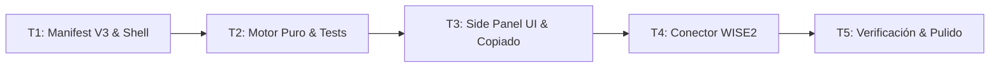

# Tasks: 001 — Validador de Año de Egreso para Seminario

> Requirements: [.ai/sdd/specs/001-validador-egreso/requirements.md](file:///c:/Users/GonzaloNicolasBalder/OneDrive%20-%20Church%20of%20Jesus%20Christ/Aplicaciones/Multiherramientas%20SEI/.ai/sdd/specs/001-validador-egreso/requirements.md)  
> Design: [.ai/sdd/specs/001-validador-egreso/design.md](file:///c:/Users/GonzaloNicolasBalder/OneDrive%20-%20Church%20of%20Jesus%20Christ/Aplicaciones/Multiherramientas%20SEI/.ai/sdd/specs/001-validador-egreso/design.md)  
> Status: Draft  
> Last Updated: 2026-10-23  

---

## Requirement Coverage

| Requisito | Tareas Mapeadas | Notas |
|-----------|-----------------|-------|
| **FR-001** (Cálculo de Ingreso y Graduación) | `T2` | Motor de cálculo puro con corte al 1/Julio y duración de 4 años |
| **FR-002** (Elegibilidad actual) | `T2`, `T3` | Clasificación de estados (`ELIGIBLE`, `TOO_YOUNG`, `EXPIRED`, `OVER_AGE`) |
| **FR-003** (Captura de fecha de WISE2) | `T4` | Script inyectable y botón *"Capturar de WISE"* |
| **FR-004** (Entrada manual y parsing) | `T2`, `T3` | Normalización de cadenas y control reactivo en Side Panel |
| **FR-005** (Copia al portapapeles) | `T3` | Botón interactivo con feedback visual |
| **FR-006** (Autoselección en WISE2) | `T4` | Inyección de selección en el dropdown `Graduation Year` |
| **FR-007** (Detección de ambigüedad) | `T2`, `T3` | Lógica de detección en parser y switch en UI |
| **NFR-001** (Usabilidad en Side Panel) | `T1`, `T3`, `T5` | Integración nativa mediante Chrome Side Panel API |
| **NFR-002** (Privacidad absoluta P-001) | `T2`, `T4`, `T5` | Ejecución 100% local sin almacenamiento persistente ni red |
| **NFR-003** (Confiabilidad y fidelidad) | `T2`, `T5` | Suite de pruebas unitarias automatizadas |
| **NFR-004** (Estética visual) | `T1`, `T3`, `T5` | Tokens de diseño, tipografía Inter y microinteracciones |

---

## Design Coverage Check

| Requisito | Cobertura en Design | Estado | Notas |
|-----------|---------------------|--------|-------|
| FR-001 | Sección 4.2 / 4.3 | Pass | Implementado en `calculator.js` |
| FR-002 | Sección 4.3 | Pass | Algoritmo determinista de 4 estados |
| FR-003 | Sección 4.4 / 5 | Pass | Conector `wise-connector.js` |
| FR-004 | Sección 4.2 | Pass | Normalizador `date-utils.js` |
| FR-005 | Sección 7.1 | Pass | Clipboard API nativa |
| FR-006 | Sección 4.4 | Pass | Manipulación segura de DOM con eventos sintéticos |
| FR-007 | Sección 4.2 / 8 | Pass | Detección de ambigüedad cuando día y mes $\le 12$ |
| NFR-001 a NFR-004 | Secciones 3, 6, 7, 10 | Pass | Cumplimiento estricto de arquitectura Manifest V3 y P-001 |

---

## Implementation Readiness Check

| Verificación | Estado | Notas |
|--------------|--------|-------|
| Todos los requisitos *Must Have* están cubiertos por tareas | Pass | `FR-001` a `FR-004` cubiertos en T1-T4 |
| Las tareas mapean a requerimientos, NFRs o decisiones de diseño | Pass | Trazabilidad completa |
| Preguntas críticas de `requirements.md` resueltas | Pass | `Q-001` y `Q-002` resueltas (`D-001`, `D-002`) |
| Las tareas tienen dependencias, criterios, archivos y verificación | Pass | T1 a T5 atomizadas y verificables |
| Comandos de verificación identificados | Pass | `npm test` (Node Test Runner / Vitest) |
| Cero bloqueadores o vacíos de diseño | Pass | Listo para fase de implementación |

---

## Implementation Slices

### Slice 1: MVP Core (Motor de Cálculo y Shell de Extensión)
- **Objetivo:** Disponer del motor matemático certificado con pruebas unitarias y el esqueleto de la extensión Manifest V3 operativo en Chrome.
- **Historias:** US-002 (Cálculo directo).
- **Tareas:** `T1`, `T2`.
- **Validación independiente:** Las pruebas unitarias pasan al 100% y la extensión se carga en `chrome://extensions`.

### Slice 2: Interfaz en Side Panel y Asistencia WISE2
- **Objetivo:** Interfaz gráfica reactiva en el Side Panel con captura bidireccional sobre WISE2 y copiado con un clic.
- **Historias:** US-001 (Captura contextual), US-003 (Copiado y autoselección).
- **Tareas:** `T3`, `T4`, `T5`.
- **Validación independiente:** Prueba manual en navegador verificando captura y selección en formulario web simulado.

---

## Task Summary

| Tarea | Título | Prioridad | Estimación | Dependencias | Estado |
|-------|--------|-----------|------------|--------------|--------|
| **T1** | Manifest V3 Shell, Service Worker y Configuración Base | P0 | 1h | Ninguna | pending |
| **T2** | Motor de Cálculo Puro, Normalizador de Fechas y Tests Unitarios | P0 | 1.5h | T1 | pending |
| **T3** | Interfaz del Validador en Side Panel con Copiado Rápido | P0 | 2h | T2 | pending |
| **T4** | Conector de WISE2 (Captura de Fecha y Autoselección en Formulario) | P1 | 2h | T3 | pending |
| **T5** | Integración Final, Estética Visual y Verificación E2E | P1 | 1h | T4 | pending |

---

## Dependency Diagram

---

## Task T1: Manifest V3 Shell, Service Worker y Configuración Base

**Prioridad:** P0  
**Estimación:** 1h  
**Dependencias:** Ninguna  
**Cubre:** NFR-001, NFR-004, TD-001  
**Estado:** pending

### Overview
Configurar el entorno base del proyecto con `package.json`, herramientas de prueba automatizadas (`npm test`), el manifiesto oficial de extensión Chrome Manifest V3 (`manifest.json`), el service worker en segundo plano para inicializar la API de Side Panel, y el contenedor HTML/CSS base del Side Panel.

### Work
- [ ] Inicializar `package.json` con scripts de test y linting sin frameworks pesados.
- [ ] Crear `src/manifest.json` declarando `manifest_version: 3`, permisos mínimos (`sidePanel`, `activeTab`, `scripting`), service worker e íconos.
- [ ] Implementar `src/background/service-worker.js` con el listener `chrome.sidePanel.setPanelBehavior({ openPanelOnActionClick: true })`.
- [ ] Crear el layout contenedor `src/sidepanel/sidepanel.html` y los tokens CSS base en `src/sidepanel/sidepanel.css` (fuentes, colores neutros/esmeralda).
- [ ] Generar íconos estándar de la extensión (16px, 48px, 128px) en formato PNG/SVG.

### Acceptance Criteria
- [ ] La carpeta `src/` puede cargarse desempaquetada en `chrome://extensions` sin errores de manifiesto ni advertencias de CSP.
- [ ] Al hacer clic en el ícono de la extensión en la barra de herramientas, se abre automáticamente el Side Panel.

### Files
- `package.json` — creación; configuración de scripts y runner de tests.
- `src/manifest.json` — creación; configuración Manifest V3.
- `src/background/service-worker.js` — creación; controlador del Side Panel.
- `src/sidepanel/sidepanel.html` — creación; esqueleto principal del Side Panel.
- `src/sidepanel/sidepanel.css` — creación; tokens de diseño y reset CSS.

### Verification
- [ ] Ejecutar comando de linter / sintaxis: `node --check src/background/service-worker.js`
- [ ] Validación de carga de extensión en navegador Chromium sin errores.

---

## Task T2: Motor de Cálculo Puro, Normalizador de Fechas y Tests Unitarios

**Prioridad:** P0  
**Estimación:** 1.5h  
**Dependencias:** T1  
**Cubre:** FR-001, FR-002, FR-004, FR-007, NFR-002, NFR-003  
**Estado:** pending

### Overview
Construir las funciones matemáticas y utilitarias puras de la herramienta sin acoplamiento al DOM: el normalizador de fechas (`date-utils.js`) y el motor de graduación de Seminario (`calculator.js`). Incluye una suite exhaustiva de pruebas unitarias que certifique la exactitud del corte al 1 de Julio contra los resultados de `Verificador seminario.html`.

### Work
- [ ] Implementar `src/shared/date-utils.js` para parsear cadenas en múltiples formatos (`DD/MM/AAAA`, `DD-MM-AAAA`, ISO) y detectar ambigüedades cuando día y mes sean $\le 12$.
- [ ] Implementar `src/tools/validador-egreso/calculator.js` con:
  - `isBornBeforeJuly1(day, month)`
  - `calculateSeminarGraduation(day, month, year, referenceDate)`
  - Evaluación exacta de edad, cohorte de 4 años y estados (`ELIGIBLE`, `TOO_YOUNG`, `EXPIRED`, `OVER_AGE`).
- [ ] Crear suite de pruebas `src/tools/validador-egreso/calculator.test.js` y `src/shared/date-utils.test.js` cubriendo todos los casos de borde de fechas.

### Acceptance Criteria
- [ ] Un alumno nacido el `30/06/2010` da ingreso `2024` y graduación `2027`.
- [ ] Un alumno nacido el `01/07/2010` da ingreso `2025` y graduación `2028`.
- [ ] El 100% de las pruebas unitarias pasan satisfactoriamente.

### Files
- `src/shared/date-utils.js` — creación; parser y normalizador de fechas.
- `src/tools/validador-egreso/calculator.js` — creación; motor puro de reglas de Seminario.
- `src/tools/validador-egreso/calculator.test.js` — creación; suite de pruebas unitarias.
- `src/shared/date-utils.test.js` — creación; pruebas de parsing y ambigüedad.

### Verification
- [ ] Ejecutar comando de pruebas automatizadas: `npm test` (salida: 100% de tests en verde).

---

## Task T3: Interfaz del Validador en Side Panel con Copiado Rápido

**Prioridad:** P0  
**Estimación:** 2h  
**Dependencias:** T2  
**Cubre:** FR-004, FR-005, FR-007, NFR-001, NFR-004  
**Estado:** pending

### Overview
Implementar la interfaz de usuario del validador dentro del Side Panel: control de fecha nativo/texto, cálculo reactivo en tiempo real al escribir o seleccionar, tarjeta destacada con el año de egreso y botón para copiar al portapapeles con microanimación de confirmación.

### Work
- [ ] Crear la plantilla visual `src/tools/validador-egreso/validador.html` e integrarla en `sidepanel.html`.
- [ ] Diseñar estilos elegantes en `src/tools/validador-egreso/validador.css`: tarjeta de graduación esmeralda, badges de cohorte, feedback visual de copiado y estados de error/fuera de edad.
- [ ] Implementar `src/tools/validador-egreso/validador.js`:
  - Listener reactivo sobre el input de fecha (cálculo instantáneo al escribir o cambiar).
  - Renderizado dinámico de la tarjeta de graduación, cohorte y grado de cursado.
  - Implementación del botón *"Copiar Año"* usando `navigator.clipboard.writeText` con tooltip temporal ("¡Copiado!").
  - Interruptor/toggle de formato para alternar día/mes en fechas ambiguas.

### Acceptance Criteria
- [ ] Al ingresar una fecha válida, el año de graduación aparece en pantalla en menos de 10ms.
- [ ] Al presionar el botón de copiado, el año queda guardado en el portapapeles y se muestra la confirmación visual.
- [ ] La interfaz se adapta armoniosamente al ancho del Side Panel de Chrome sin barras de desplazamiento horizontales.

### Files
- `src/tools/validador-egreso/validador.html` — creación; marcado HTML del componente.
- `src/tools/validador-egreso/validador.css` — creación; estilos del validador y tarjetas.
- `src/tools/validador-egreso/validador.js` — creación; controlador de eventos y UI.
- `src/sidepanel/sidepanel.js` — modificación; inicialización y carga del módulo.

### Verification
- [ ] Validación de eventos y renderizado mediante test unitario/DOM en `npm test`.
- [ ] Verificación manual visual en el Side Panel.

---

## Task T4: Conector de WISE2 (Captura de Fecha y Autoselección en Formulario)

**Prioridad:** P1  
**Estimación:** 2h  
**Dependencias:** T3  
**Cubre:** FR-003, FR-006, NFR-002, TD-002  
**Estado:** pending

### Overview
Implementar la integración contextual con la plataforma WISE2 mediante inyección de scripts bajo demanda: botón *"Capturar de WISE"* para leer automáticamente la fecha de nacimiento del campo `Birthdate` de la pestaña activa, y botón *"Aplicar en WISE2"* para autoseleccionar el año de graduación calculado en el desplegable `Graduation Year`.

### Work
- [ ] Implementar `src/content/wise-connector.js` con las rutinas autónomas:
  - `extractWiseBirthdate()`: búsqueda tolerante por atributos `name`, `id`, `aria-label` o etiquetas que contengan "birth" o "nacimiento".
  - `applyWiseGraduationYear(year)`: localización del selector `Graduation Year`, selección de la opción coincidente y emisión de eventos sintéticos `input` y `change`.
- [ ] Conectar los botones en `src/tools/validador-egreso/validador.js` mediante `chrome.tabs.query` y `chrome.scripting.executeScript`.
- [ ] Implementar manejo de errores amigable: avisar con claridad si la pestaña activa no es WISE2 o si el campo de fecha está vacío, sin romper la ejecución.

### Acceptance Criteria
- [ ] Al hacer clic en *"Capturar de WISE"*, el valor de fecha en la pestaña activa se copia al input del Side Panel y se ejecuta el cálculo de inmediato.
- [ ] Al hacer clic en *"Aplicar en WISE2"*, el campo `Graduation Year` de WISE2 queda seleccionado con el año calculado.
- [ ] Si la pestaña activa no tiene un campo de fecha válido, se muestra un mensaje informativo sin lanzar excepciones no controladas.

### Files
- `src/content/wise-connector.js` — creación; script inyectable en WISE2.
- `src/tools/validador-egreso/validador.js` — modificación; integración de llamadas a `chrome.scripting`.

### Verification
- [ ] Pruebas unitarias de las funciones de `wise-connector.js` con mocks de DOM.
- [ ] Verificación interactiva contra una página HTML de prueba con la estructura exacta de WISE2.

---

## Task T5: Integración Final, Estética Visual y Verificación E2E

**Prioridad:** P1  
**Estimación:** 1h  
**Dependencias:** T4  
**Cubre:** NFR-001, NFR-002, NFR-003, NFR-004  
**Estado:** pending

### Overview
Realizar la auditoría de calidad, empaquetado, verificación E2E en navegador Chrome y pruebas de integración con el archivo de referencia `Verificador seminario.html` para asegurar que la extensión cumpla con los más altos estándares visuales, de rendimiento y privacidad antes de proceder a la revisión final.

### Work
- [ ] Realizar una pasada de refinamiento estético: contrastes de color, microanimaciones suaves, accesibilidad por teclado y tipografía.
- [ ] Verificar que no existan fugas de memoria ni llamadas de red externas (cumplimiento estricto del Principio P-001).
- [ ] Ejecutar la suite completa de pruebas automatizadas y asegurar 100% de aprobación.
- [ ] Probar la extensión de principio a fin en Chrome (carga desempaquetada, uso en Side Panel, captura y autocompletado).

### Acceptance Criteria
- [ ] `npm test` ejecuta todas las pruebas unitarias y de integración con resultado exitoso.
- [ ] El flujo completo (captura de fecha, cálculo instantáneo, copiado y aplicación en WISE2) funciona sin fisuras.
- [ ] Cero advertencias o errores en la consola de Chrome DevTools.

### Files
- `src/sidepanel/sidepanel.css` — ajustes de pulido visual y responsive.
- Documentación y scripts de verificación.

### Verification
- [ ] Ejecutar comando completo: `npm test`
- [ ] Inspección en navegador con Chrome DevTools.

---

## Reglas de Finalización

- No marcar ninguna tarea como completada sin evidencia observable ejecutable (comando, código de salida y resultado).
- Las pruebas automatizadas acompañan al código en cada tarea (`T1` a `T5`).
- Si surge alguna discrepancia con los requisitos o el diseño técnico, detenerse y actualizar el documento fuente bajo la compuerta correspondiente.
